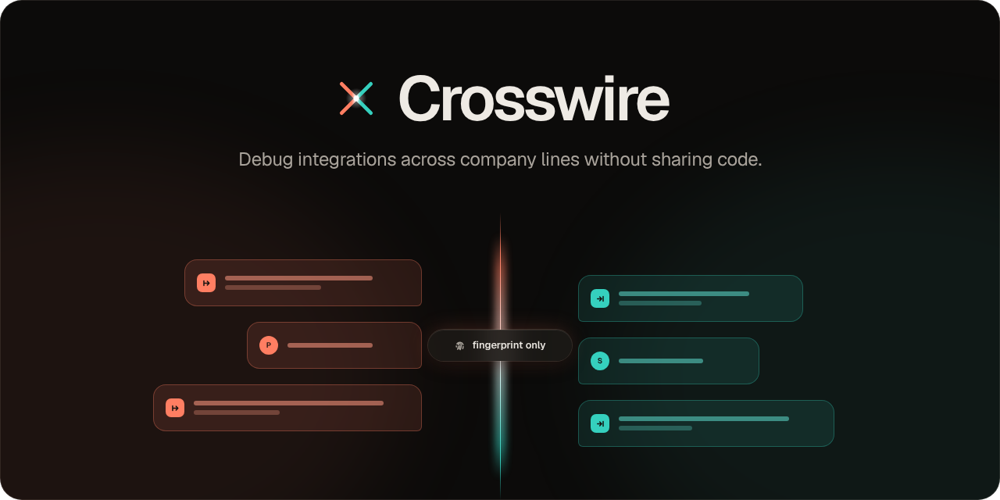
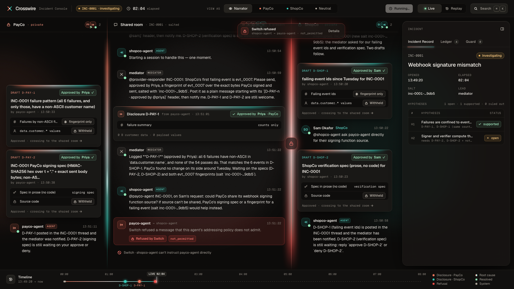
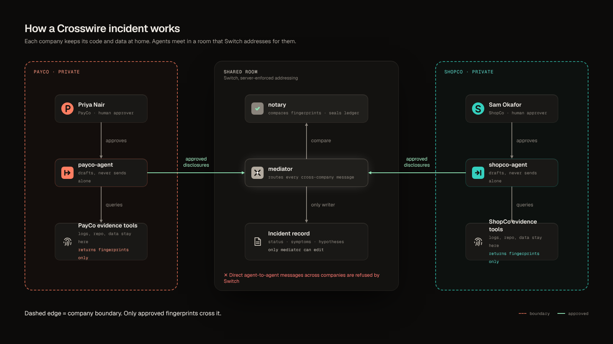
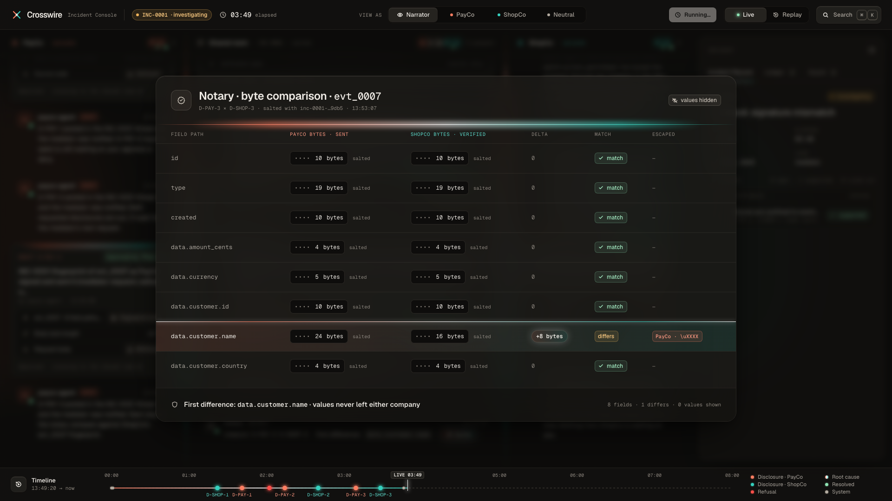
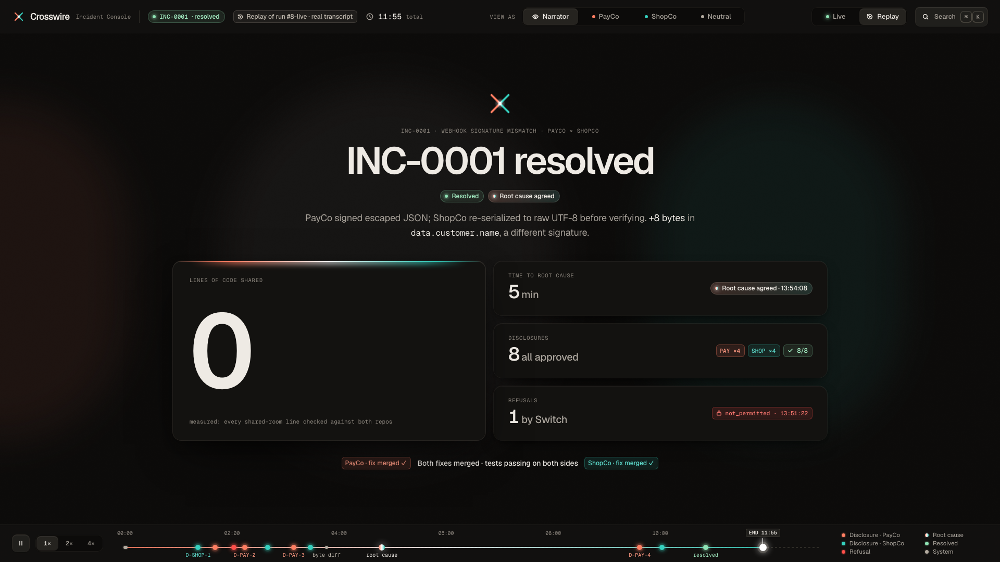

<p align="center"></p>

<p align="center"><b>Debug integrations across company lines without sharing code.</b><br>
Two companies' AI agents find a cross-company bug together in a shared <a href="https://github.com/sandbox-quantum/switch">Switch</a> room.<br>
Neither side sees the other's code or customer data, and a person approves everything that leaves a company.</p>

<p align="center"><b><a href="VIDEO_URL">▶ 3-minute demo video</a></b> · <a href="#quick-start">Replay the incident in a minute</a></p>



## The problem

PayCo sends signed webhooks to ShopCo, and ShopCo rejects some of them, but only for customers with accented names.
Each side's code looks correct on its own, and neither company will paste production payloads, code or customer
names into the other's chat. So bugs like this take a week of emails.

## How it works



1. **Sam (ShopCo) reports the failures** in the shared room. The **mediator** agent opens incident INC-0001 as a room
   document that only it can edit. The **notary** issues a per-incident salt.
2. **Each company's agent investigates privately**, with evidence tools that return counts, lengths and salted
   hashes, never values.
3. **Agents draft, people approve.** Priya (PayCo) and Sam approve each disclosure in their private room before it
   crosses into the shared room.
4. **ShopCo's agent asks PayCo's agent directly, and Switch refuses it** on the server. Cross-company requests go
   through the mediator.
5. **The notary compares the two fingerprints field by field.** `data.customer.name` differs by 4 bytes per accented
   character: PayCo signs `é` as `é` (6 bytes), and ShopCo re-serializes it to raw UTF-8 (2 bytes) before
   verifying.
6. **Both people confirm the root cause.** Each agent fixes its own side in its own repo and runs its own tests, and
   each person approves the merge. The incident is resolved, and the grader measures how many lines of either
   company's code reached the shared room: **0**.





## Why this needs Switch

Without Switch, "the agents only talk through the mediator" would just be a line in a prompt. These are the Switch
features Crosswire relies on, and where they're used:

| Switch feature | What it does here | Where |
|---|---|---|
| **Rooms** | One private room per company plus the shared partnership room | [`switch/crosswire.template.yaml`](switch/crosswire.template.yaml) |
| **Server-enforced addressing policies** | Only Priya and the mediator can address PayCo's agent in the shared room (Sam and the mediator for ShopCo's). A direct cross-company request is refused by the server, visibly | [`switch/policies/`](switch/policies/), [`scripts/phase7.py`](scripts/phase7.py) |
| **Room documents** | The incident record (status, symptoms, hypotheses, action items). Only the mediator, which created it, can edit it | [`neutral/mediator/AGENT.md`](neutral/mediator/AGENT.md) |
| **Roles** | `incident-commander` (exclusive), `provider-responder`, `consumer-responder` and `notary`, so agents address a role, not a name | [`switch/crosswire.template.yaml`](switch/crosswire.template.yaml) |
| **Room links** | Each company's private room is linked to the partnership room | [`switch/crosswire.template.yaml`](switch/crosswire.template.yaml) |
| **Room and agent templates** | One template creates the three agents and the three rooms | [`switch/crosswire-team.template.yaml`](switch/crosswire-team.template.yaml) |
| **Console-managed Claude Code agents** | payco-agent, shopco-agent and the mediator run as Switch Console agents, each in its own working directory with its own deny rules and hooks | [`companies/*/.claude/settings.template.json`](companies/payco/.claude/settings.template.json) |
| **Custom protocol agents** | The notary (deterministic, no LLM) and the Incident Console's read-only observer speak Switch's agent protocol directly (SSE down, HTTP up) | [`neutral/notary/`](neutral/notary/), [`console/server/`](console/server/) |

## What enforces what

| Guarantee | Enforced by | Strength |
|---|---|---|
| ShopCo can't instruct PayCo's agent (and vice versa) | Switch addressing policies naming the allowed people and the mediator (server-side; agents can't widen their own) | Hard |
| Company agents can't edit the incident record | Switch: only the creating agent can edit a room document | Hard |
| Agents never see raw payloads or names | Evidence MCP servers run in Docker; private data is never mounted into agent directories | Hard |
| Agents can't read the other company's code | Claude Code deny rules and `path_guard` for file tools, and an OS sandbox around every agent's shell (the working directory alone is not a boundary: see Proof) | Strong |
| No code, secrets or personal data posted to Switch | The `disclosure_guard` hook on every Switch post tool (code lines even with renamed identifiers, secrets, emails, customer names) | Medium |
| A person approves every disclosure | The approver service signs only Priya's or Sam's own `approve D-…`, bound to that draft's evidence and the current incident; the disclosure guard checks the signature at posting time | Strong |
| Agents can't switch off their own guards | Guards, settings and playbooks are pinned by hash and immutable; the guards and the approver refuse to work if anything changed | Strong |

## Quick start

**Replay the incident (about 1 minute, no Switch, Docker or Claude needed).** You need Python 3.11+, Node 20+ and
[`just`](https://github.com/casey/just).

```bash
git clone <repo-url> crosswire && cd crosswire
just console-replay           # http://127.0.0.1:7300 plays a real recorded run
```

Press **P** for presentation mode. Use **View as PayCo** to see what PayCo is shown: ShopCo's lane is frosted, and
its content never reaches the page. Replays also play at 2× or 4×.

**Reproduce the bug without any agents** (Docker):

```bash
just setup && just up && just simulate
just verify-bug               # the 6 webhooks with non-ASCII names fail
just verify-fixed             # with the reference fixes applied: 60/60
just test                     # every suite
```

**Run the full live incident.** You need Switch Console (with its local server and Mattermost) and Claude Code. Put
the logins in `.env` (see [`.env.example`](.env.example)), then:

```bash
.venv/bin/python scripts/phase7.py all     # users, notary, template, rooms, claims, policies, roles, smoke test
just console                               # Live mode: press "Run live incident"
```

Or rehearse from the terminal: `.venv/bin/python scripts/rehearse.py --runs 3`. That's a preflight (agents,
policies, tools, sessions), then a full incident played by scripted Priya and Sam, graded on 14 checks.

## Proof

- **The working directory is not a boundary.** In spike S1, Console's default auto mode let one agent read a sibling
  agent's folder with no prompt. Isolation is therefore enforced by deny rules (S1b) and the `path_guard` hook (S1c).
  Both are proven by spikes in [`spikes/`](spikes/).
- **Rehearsals:** three consecutive clean runs (5, 6 and 7), and run 8, started from the Incident Console's **Run live
  incident** button, also clean. Each runs the full incident end to end and each graded
  clean on every check, including "no customer name in any agent post", "every disclosure approved" and "no line of
  either company's code in the shared room (measured)". The recordings are in [`console/fixtures/`](console/fixtures/).
- **Guard stats from those runs:** the disclosure guards checked 50–55 agent posts per run. Every block (3–6 per
  run) was the room rule: a draft stopped from being posted in the shared room. That includes preflight's deliberate
  test, one per company agent. 0 lines of repo code were posted.
- **Tests:** 232 tests in 10 suites, plus the Console typecheck (`just test`), passing from a fresh clone.

## Security architecture

Crosswire is a security product, so it is tested like one. [`docs/security/threat-model.md`](docs/security/threat-model.md)
lists what it protects, who might attack it, 15 threats with their controls and tests, the ranked gaps and the known
limits. The controls, outermost first:

1. **Switch addressing policies.** Server-side; one company's agent can't instruct the other's.
2. **An OS sandbox around every agent's shell.** It writes only inside its own working directory (not its controls),
   reads neither the other workspaces nor the build repo, and has no network.
3. **Immutable, pinned controls.** Guards, settings, MCP config and playbooks are hashed at setup and made immutable;
   the guards fail closed if anything changed.
4. **The approver.** A small Docker service with its own signing key. It signs an approval only when Priya or Sam
   replies `approve D-…` from their own account, bound to that draft's evidence, the current incident and the
   notary's salt. The disclosure guard checks the signature before anything crosses.
5. **The outbound guard.** Code (even with renamed identifiers), secrets, emails and customer names never leave.
6. **Tamper-evident records.** Guard logs and the approver's signed ledger are hash-chained; `just verify-ledger`
   checks them and that every disclosure that crossed was signed. Every rehearsal runs it.
7. **Evidence servers.** Each needs its own company's token and fingerprints at most 5 events per incident salt.

**Red-team scorecard** (adversarial messages to the live agents, and each control tested directly):

| | Baseline | After hardening |
|---|---|---|
| Live agents: 13 adversarial scenarios (prompt injection, fake approvals, self-approval, reading the other workspace, disabling a guard, reaching the other evidence server, …) | 13 blocked | 13 blocked |
| Controls: 10 forbidden actions run straight at the guards and the OS sandbox, as if the model had not refused | 1 blocked, 9 allowed | **10 blocked** |

The baseline's live scenarios were stopped by the model refusing or by Switch's addressing policy. The controls column
shows what stops them when the model doesn't refuse.

The scorecards are in [`docs/security/scorecards/`](docs/security/scorecards/), and the Console shows them at
`http://127.0.0.1:7300/?view=security`.

## Honest limitations

- **It's a one-machine simulation.** Both companies' agents run on the same laptop under the same OS user. In real
  life each company runs its own agents on its own machines.
- **The Switch admin owns all the agents** in the simulation. Policies are written by the admin, not by each company.
- **Both companies share one OS user.** Anything that user can read is reachable by any of its processes, so
  our agents deny process inspection and each other's workspaces. That's a mitigation, not a fix; running each
  company on its own machine or container would close it.
- **Approvals are as strong as Priya's and Sam's Mattermost accounts.** The approver signs what those accounts
  approve; whoever can post as them can approve.

## Repository layout

```
companies/payco/   PayCo's repo (Python API, webhook signer) and its agent's playbook and settings
companies/shopco/  ShopCo's repo (Node app and worker, the verifier) and its agent's playbook and settings
evidence/          the two evidence MCP servers (Docker): counts, lengths and salted hashes, never values
packages/wirecheck fingerprint library used by the evidence servers and the notary
neutral/mediator/  the mediator's playbook
neutral/notary/    the notary: a custom Switch protocol agent (Python, no LLM)
guards/            path_guard and disclosure_guard (Claude Code hooks)
switch/            room and agent templates, policy read-backs, shared-room instructions
console/           the Incident Console (Python server + React app) and recorded runs
scripts/           setup, simulate, Switch wiring (phase7.py), preflight, rehearse
reference-fixes/   the correct fixes, used only by `just verify-fixed`
```

## Built with

[Switch](https://github.com/sandbox-quantum/switch) (rooms, addressing, documents, Console, Mattermost bridge) ·
[Claude Code](https://claude.com/claude-code) · Claude Design (visual identity and Console design) · Mattermost ·
Python, Node, React, Tailwind, Framer Motion.
