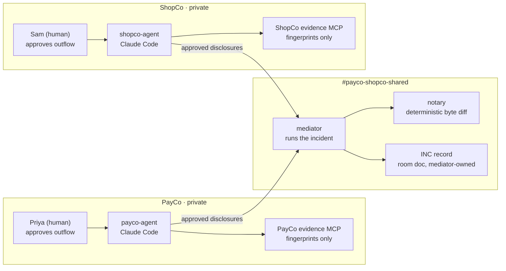

# Crosswire architecture

> Debug integrations across company lines without sharing code.

Vector version: [design/diagram/crosswire-architecture-1600x900.svg](design/diagram/crosswire-architecture-1600x900.svg).

## The concept

PayCo (an API provider) sends signed webhooks to ShopCo (its customer). Signatures fail **only for customers with accented names**:

- PayCo signs the exact bytes it sends. Python's `json.dumps` escapes non-ASCII, so `é` is sent as `\u00e9` (6 bytes).
- ShopCo's worker gets the **parsed** JSON from a queue (the raw bytes are gone by then) and verifies over `JSON.stringify(payload)`, which writes `é` raw (2 bytes in UTF-8).
- The bytes differ by **4 bytes per accented character**, so the signature fails.

Each side's code looks correct on its own:

- **PayCo** knows that only non-ASCII payloads fail, but its signing follows its spec.
- **ShopCo** knows it re-serializes, but its logs contain no names, so it can't see that pattern.

Neither can share code or customer data with the other. In a shared Switch room, a neutral **Mediator** agent runs the incident. Each company's agent shares only **fingerprints** (sizes, hashes, JSON field paths), and each company's human approves every disclosure. A deterministic **Notary** agent compares the fingerprints and shows `customer.name` differs by 4 bytes. Both sides agree on the root cause, each fixes its own code, and the agreement is recorded in a document that only the Mediator can edit.

### Architecture

### Design principles (these go in the README too)

1. **Privacy by design.** Agents never see raw payloads. Evidence tools return fingerprints only.
2. **Every cross-company request goes through the Mediator.** Company agents accept requests only from their own human and the Mediator. Switch addressing policies enforce this on the server.
3. **Language models reason; plain code verifies.** The Notary is not an AI. The core evidence is calculated, not guessed.
4. **Everything that crosses the company line is approved and logged.** The disclosure ledger records what was shared, who approved it and when.
5. **Agents are addressed by role, not name.** `provider-responder`, `consumer-responder` and `incident-commander`, so any agent can be swapped in.

### What enforces what

| Guarantee | Enforced by | Strength |
|---|---|---|
| ShopCo can't instruct PayCo's agent (and vice versa) | Switch addressing policy naming the allowed humans (Priya / Sam) and the mediator (server-side; agents can't widen their own) | Hard |
| Company agents can't edit the incident record | Switch: only the creating agent can edit a room document | Hard |
| Agents never see raw payloads or names | Evidence MCP servers run in Docker; private data never mounted into agent directories | Hard |
| Agents can't read the other company's code | Deny rules for file tools (checked **before** hooks; proven by S1b) plus the `path_guard` hook for Bash (proven by S1c). **Not** the working directory: S1 showed auto mode reads outside it with no prompt. | Medium (Hard with containers, 11.7) |
| One company's agent can't impersonate the other | In real life: each company runs its agents on its own machines. In the one-machine simulation, both companies' agents run as one OS user, so both agents deny process-inspection commands (`ps`, `pgrep`, `lsof`, `top`, `launchctl`, `sysctl`). | Soft in the simulation (Hard with containers, 11.7) |
| No code, secrets or personal data posted to Switch | `disclosure_guard` PreToolUse hook on Switch post tools | Medium |
| A human approves every disclosure | Agent instructions plus the ledger (Hard with stretch goal 11.5) | Soft |

## Information split

| | PayCo can see | ShopCo can see |
|---|---|---|
| Which events failed | Yes (401 responses) | Yes (mismatches) |
| That failures are all non-ASCII | **Yes** (`summarize_failures`) | **No** |
| That bytes get re-serialized | **No** | **Yes** (own code) |
| Where the bytes differ | Only together (Notary) | Only together (Notary) |

## Rooms and agents

| Agent | Working dir | Owner | Shared-room role | Runtime |
|---|---|---|---|---|
| `payco-agent` | `workspace/payco` | admin (addressed by Priya) | `provider-responder` | Claude Code via Console |
| `shopco-agent` | `workspace/shopco` | admin (addressed by Sam) | `consumer-responder` | Claude Code via Console (Codex optional) |
| `mediator` | `workspace/mediator` | admin | `incident-commander` | Claude Code via Console |
| `notary` | n/a | admin | `notary` | custom Python, raw Switch protocol |

Rooms: `#payco-internal`, `#shopco-internal`, `#payco-shopco-shared` (linked).
